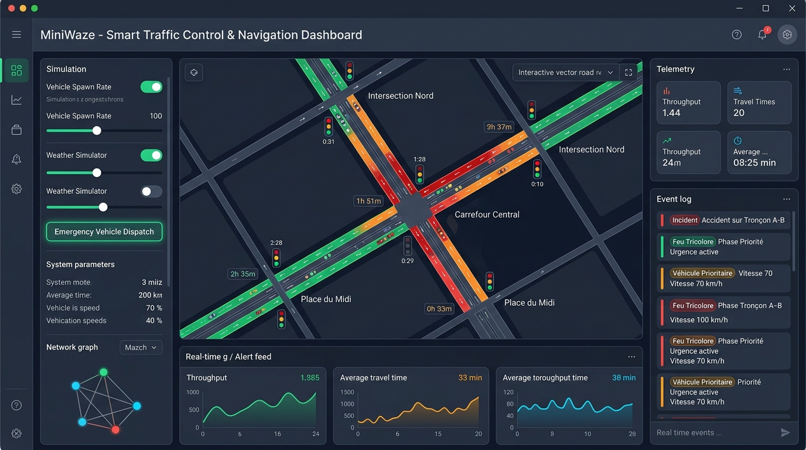
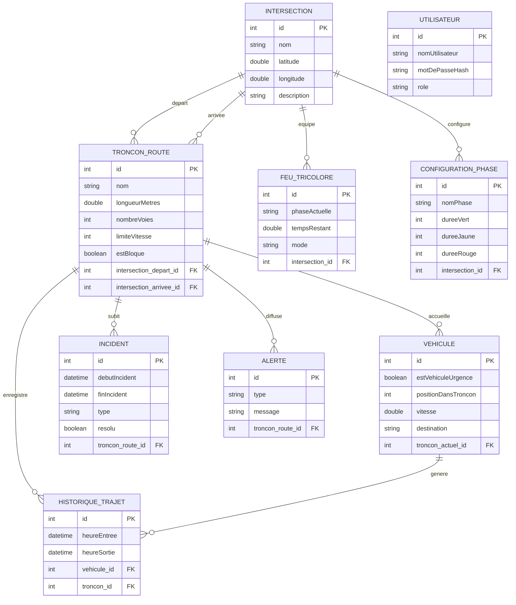

# 🚦 MiniWaze — Simulateur & Gestionnaire de Trafic Urbain Décentralisé

<p align="center">
  
  
  
  
  
  
  
</p>

<p align="center">
  
</p>

---

## 📌 Présentation du Projet

**MiniWaze** est une application desktop moderne de **supervision, modélisation et simulation du trafic routier urbain** sur un secteur géographique délimité. Inspirée des concepts clés de plateformes de navigation collaborative comme Waze, elle permet de représenter un graphe routier complexe, d'orchestrer la régulation des flux de circulation par carrefours à feux tricolores intelligents, et de gérer dynamiquement les aléas de la route (incidents, embouteillages, véhicules d'urgence prioritaires).

L'application repose sur une architecture Java moderne à base de **JavaFX** pour l'interface graphique interactive et de **JPA / Hibernate ORM** pour la persistance relationnelle et la traçabilité complète des trajets et événements.

---

## 📸 Aperçu & Interface Utilisateur

<p align="center">
  
  <br />
  <em>Interface de supervision du réseau routier MiniWaze : Cartographie interactive, monitoring des feux tricolores et flux d'alertes en temps réel.</em>
</p>

---

## 🌟 Fonctionnalités Principales

- 🗺️ **Modélisation Topologique du Réseau Routier** :
  - Représentation sous forme de graphe : les **Intersections** constituent les nœuds et les **Tronçons de Route** constituent les arêtes orientées.
  - Gestion des caractéristiques physiques : longueur en mètres, nombre de voies, vitesses maximales autorisées, coordonnées GPS (latitude/longitude).

- 🚦 **Régulation Intelligente des Feux Tricolores** :
  - Gestion des cycles de feux (Vert, Jaune, Rouge) avec durées configurables par phase (`ConfigurationPhase`).
  - Prise en charge de modes multiples : mode fixe régulier, adaptatif selon la densité, et mode priorité véhicule d'urgence.

- 🚑 **Gestion et Priorisation des Véhicules** :
  - Suivi des véhicules en déplacement sur chaque tronçon avec vitesse instantanée et position relative.
  - Détection et gestion prioritaire des véhicules de secours (`estVehiculeUrgence`).

- ⚠️ **Système d'Alertes & Traitement des Incidents** :
  - Signalement instantané des aléas routiers : accidents, travaux de voirie, obstacles ou conditions météorologiques défavorables.
  - Blocage automatique ou manuel de tronçons (`estBloque`) et diffusion d'alertes géolocalisées aux conducteurs.

- 📈 **Historique & Analyse des Flux (Big Data Traffic)** :
  - Archivage systématique des temps de parcours (`heureEntree`, `heureSortie`) sur chaque tronçon pour le calcul des temps de trajet moyens et l'optimisation des itinéraires.

---

## 🏗️ Architecture & Modèle de Données

### Diagramme Entité-Association (ERD)



---

## 📂 Structure du Projet

```
miniWaze/
├── pom.xml                               # Configuration Maven (Java 23, JavaFX 17, Hibernate 6.4, MySQL)
├── mvnw / mvnw.cmd                       # Maven Wrapper multiplateforme
├── docs/
│   └── screenshots/                      # Assets visuels & captures d'écran
│       ├── miniwaze_banner.png           # Bannière du projet
│       └── miniwaze_dashboard.png        # Mockup de l'interface utilisateur
├── src/
│   └── main/
│       ├── java/
│       │   ├── module-info.java          # Déclaration du module JavaFX / JPMS
│       │   └── org/example/miniwaze/
│       │       ├── Main.java             # Point d'entrée de l'application JavaFX
│       │       ├── HelloController.java  # Contrôleur FXML
│       │       ├── model/                # Entités JPA du domaine routier
│       │       │   ├── Alerte.java
│       │       │   ├── ConfigurationPhase.java
│       │       │   ├── FeuTricolore.java
│       │       │   ├── HistoriqueTrajet.java
│       │       │   ├── Incident.java
│       │       │   ├── Intersection.java
│       │       │   ├── TronconRoute.java
│       │       │   ├── Utilisateur.java
│       │       │   └── Vehicule.java
│       │       └── util/                 # Utilitaires de persistance
│       │           ├── HibernateUtil.java
│       │           └── JpaUtil.java
│       └── resources/
│           ├── META-INF/
│           │   └── persistence.xml       # Configuration de l'Unité de Persistance (miniwazePU)
│           └── org/example/miniwaze/
│               └── hello-view.fxml       # Définition de la vue FXML
└── .gitignore                            # Exclusions standards (target, IDEs, etc.)
```

---

## 🚀 Installation & Lancement

### 1. Prérequis
- **JDK 17 ou supérieur** (idéalement JDK 21 ou 23)
- **Maven 3.8+** (ou utilisation du wrapper inclus `./mvnw`)
- **Serveur MySQL** (local ou conteneur Docker)

### 2. Configuration de la Base de Données

Créez la base de données MySQL :
```sql
CREATE DATABASE miniwaze CHARACTER SET utf8mb4 COLLATE utf8mb4_unicode_ci;
```

Ajustez si nécessaire vos identifiants de connexion dans le fichier [`src/main/resources/META-INF/persistence.xml`](src/main/resources/META-INF/persistence.xml) :
```xml
<property name="jakarta.persistence.jdbc.url" value="jdbc:mysql://localhost:3306/miniwaze?useSSL=false&amp;serverTimezone=UTC"/>
<property name="jakarta.persistence.jdbc.user" value="root"/>
<property name="jakarta.persistence.jdbc.password" value="votre_mot_de_passe"/>
```

> **Note :** Grâce à la propriété `hibernate.hbm2ddl.auto = update`, les tables SQL sont automatiquement créées et mises à jour lors du premier lancement de l'application.

### 3. Compilation & Exécution de l'Application

Sous Linux / macOS :
```bash
./mvnw clean javafx:run
```

Sous Windows :
```cmd
mvnw.cmd clean javafx:run
```

Ou en compilant le package complet :
```bash
mvn clean package
```

---

## 🔮 Roadmap & Améliorations Futures

- [ ] **Moteur de Pathfinding Dijkstra / A*** : Calcul dynamique du plus court chemin tenant compte du coefficient d'embouteillage sur chaque tronçon.
- [ ] **Simulation Temps Réel Multi-Threadée** : Boucle de simulation dynamique déplaçant les véhicules sur le canevas JavaFX à intervalles réguliers.
- [ ] **API REST & WebSockets** : Exposition d'une couche backend pour connecter des clients mobiles conducteurs en temps réel.
- [ ] **Génération Automatique de Données Réseau (OpenStreetMap)** : Module d'importation de fichiers `.osm` pour simuler n'importe quelle ville réelle.

---

## 📄 Licence

Ce projet est sous licence **MIT**. Vous êtes libre de l'utiliser, l'étudier, le modifier et le distribuer dans vos projets académiques et professionnels.
